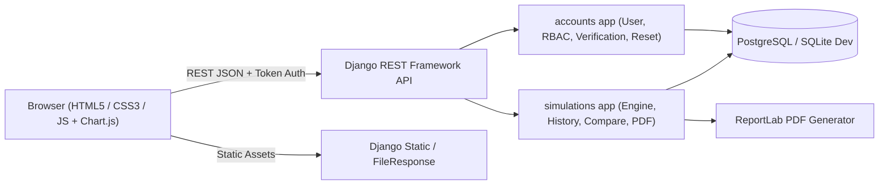
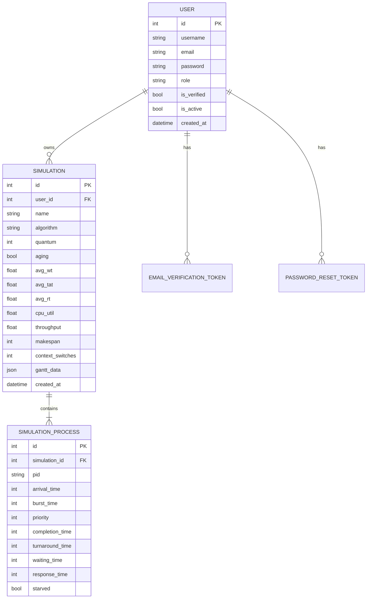

# CPU Process Scheduling Simulator — Full-Stack OS Learning Platform

A full-stack Operating Systems & Data Structures educational web application built with **HTML5, CSS3, Vanilla JavaScript, Chart.js, Python Django, Django REST Framework (DRF), PostgreSQL, and ReportLab**.

---

## Key Features

- **10 CPU Scheduling Algorithms** (with step-by-step animation, forward/backward scrubbing, I/O blocking, priority aging, and starvation detection):
  1. First Come First Serve (`FCFS`) — Queue (FIFO)
  2. Shortest Job First (`SJF`) — Min-Heap
  3. Shortest Remaining Time First (`SRTF`) — Preemptive Min-Heap
  4. Priority Scheduling Non-Preemptive (`PRIORITY_NP`) — Priority Queue
  5. Priority Scheduling Preemptive (`PRIORITY_P`) — Preemptive Priority Queue
  6. Round Robin (`RR`) — Circular Queue
  7. Highest Response Ratio Next (`HRRN`) — Dynamic Response Ratio
  8. Multilevel Queue (`MLQ`) — 3-Level Priority Queues (`Q0: RR`, `Q1: RR2`, `Q2: FCFS`)
  9. Multilevel Feedback Queue (`MLFQ`) — Adaptive Demotion & Aging Boost
  10. Lottery Scheduling (`LOTTERY`) — Proportional-Share Ticket Pool
- **Hand-Written Data Structures**: `ProcessArray`, `LinkedList`, `Queue`, `MinHeap`, and `PriorityQueue` with live operation logs and interactive playgrounds.
- **Secure Production Authentication & RBAC**:
  - Django `PBKDF2` password hashing, DRF Token Authentication, Email Verification tokens, Password Reset flow, and `STUDENT` / `ADMIN` role-based access control.
- **User Dashboard & Private Simulation History**:
  - Real database-computed metrics, saved simulation CRUD, side-by-side comparison of saved runs, and profile/password management.
- **Downloadable PDF Reports**:
  - Generated server-side with ReportLab including process tables, vector Gantt chart, execution timeline, performance metrics, 10-algorithm comparison, and final summary.
- **Administrator Dashboard**:
  - Platform analytics, algorithm usage chart, recent activity feed, and user activation/deactivation & role management.
- **Modern Responsive UI**:
  - Collapsible sidebar navigation, dark/light theme toggle, interactive Chart.js graphs, Practice Questions quiz, and Viva Q&A.

---

## System Architecture



---

## Database ER Diagram



---

## REST API Reference

| Endpoint | Method | Auth | Description |
|---|---|---|---|
| `/api/health/` | `GET` | Public | API & DB health check |
| `/api/auth/register/` | `POST` | Public | Register a new Student account |
| `/api/auth/login/` | `POST` | Public | Authenticate via username/email & password |
| `/api/auth/logout/` | `POST` | Token | Invalidate current auth token |
| `/api/auth/me/` | `GET`, `PATCH` | Token | View or update current user profile |
| `/api/auth/change-password/` | `POST` | Token | Change password (authenticated) |
| `/api/auth/verify-email/` | `GET`, `POST` | Public | Verify email using verification token |
| `/api/auth/resend-verification/` | `POST` | Token | Resend email verification link |
| `/api/auth/password-reset/` | `POST` | Public | Request password reset token |
| `/api/auth/password-reset/confirm/` | `POST` | Public | Confirm password reset with token |
| `/api/simulations/` | `GET`, `POST` | Token | List own simulations / save new simulation |
| `/api/simulations/<id>/` | `GET`, `DELETE` | Owner/Admin | Get simulation details or delete |
| `/api/simulations/<id>/pdf/` | `GET` | Owner/Admin | Download ReportLab PDF report |
| `/api/simulations/compare/` | `POST` | Public | Compare all 10 algorithms on workload |
| `/api/dashboard/` | `GET` | Token | User dashboard analytics & recent runs |
| `/api/auth/admin/stats/` | `GET` | Admin | Platform-wide statistics & algorithm usage |
| `/api/auth/admin/users/` | `GET` | Admin | List all registered users |
| `/api/auth/admin/users/<id>/` | `PATCH` | Admin | Activate/deactivate user or update role |

---

## Installation & Setup

### 1. Clone & Create Virtual Environment
```bash
python -m venv venv
# Windows:
venv\Scripts\activate
# macOS/Linux:
source venv/bin/activate

pip install -r requirements.txt
```

### 2. Configure Environment Variables
Copy `.env.example` to `.env` and set your `SECRET_KEY` and PostgreSQL credentials:
```bash
cp .env.example .env
```
- For **PostgreSQL**, set `DB_ENGINE=postgresql`, `DB_NAME=cpu_scheduler_db`, `DB_USER`, `DB_PASSWORD`, `DB_HOST`, and `DB_PORT`.
- For **quick local development** without PostgreSQL installed, set `DB_ENGINE=sqlite`.

### 3. Run Migrations & Create an Administrator
```bash
cd backend
python manage.py migrate
python manage.py createsuperuser
```
*(In Django admin or shell, set `role = 'ADMIN'` on your superuser if needed; `is_superuser=True` automatically grants admin permissions.)*

### 4. Start the Server
```bash
python manage.py runserver
```
Open `http://127.0.0.1:8000/` in your browser.

---

## Running Tests

```bash
cd backend
python manage.py test -v 2
```
Includes unit tests for all 10 scheduling algorithms, authentication, email verification, password reset, RBAC permissions, simulation privacy, PDF generation, and admin endpoints.
